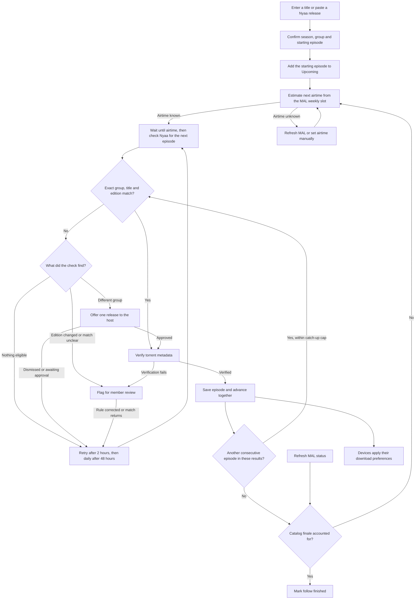

# WatchPair airing series workflow

Implementation and pilot workflow · 19 November 2026

## What following a series does

In a room, choose **Add media → Follow a series** and enter a title, a MyAnimeList anime link, or a Nyaa release link. Confirm the catalog season or part and select the Nyaa release to follow. Confirming the preview adds that episode immediately if it is missing, then follows the next numbered episode. For example, an episode 7 anchor adds 7 and starts looking for 8. Earlier episodes can still be added through the usual queue controls.

To start from an episode already in the room, select it in **Upcoming** or **Watched** and choose **More → Follow this series**. If WatchPair can verify its original Nyaa listing, it preselects that release. Otherwise, search for a reference release of the same episode or paste its Nyaa link. Confirming the follow preserves the selected entry and begins looking for the next episode.

The coordinator uses MyAnimeList (MAL) to estimate when to start looking for the next episode. It checks Nyaa at or shortly after that time, then about every two hours for the first 48 hours. If the episode is still missing, the check slows to once a day. After a match, the same results can supply up to three consecutive verified episodes in total. Otherwise the coordinator waits for the following episode’s expected airtime. This works even when all desktop apps are closed. Each verified episode appears at the end of Upcoming in normal queue order, without changing the currently selected episode or starting playback. Everyone can reorder or remove it and mark it watched as usual. Each device applies its existing Auto, Ask, or Never setting. Under Ask, the ordinary Download action appears on that episode. Under Never, the device starts no media download. The current desktop may still fetch torrent metadata while reconciling a room source.

When a VPS request to Nyaa times out, WatchPair can try connected room desktops for the listing, RSS search, or torrent metadata. It tries one desktop per observed public IP for each request, then waits at least one minute before repeating an exhausted round. The coordinator parses the listing or feed and verifies the torrent’s info hash and media before adding an episode. During setup, the dialog shows that it is trying connected desktops.

Any room member can create, edit, pause, resume, or stop a follow. The current room host approves a one-time release from another group. Each rule covers one confirmed season or part. A later season or separately listed part needs its own follow. Stopping a rule keeps its already added episodes and history.

### Device-first Nyaa lookup and season review

In 2.0.4, a slow VPS request can consume 10 seconds before the coordinator asks a desktop. Desktops are chosen in connection order, so the device that started the search may wait behind another room member. A silent desktop can hold its turn for 25 seconds. Even when a desktop answers immediately, the preview dialog waits for its next 6.5-second poll. Listing lookup, RSS search, and torrent verification can incur these delays independently. A scheduled check can also wait for the coordinator’s next 15-second tick. [Provider timeout](../v2/coordinator/src/series-provider.ts) · [Fallback rounds](../v2/coordinator/src/series-metadata.ts) · [Desktop selection](../v2/coordinator/src/server.ts) · [Preview dialog](../v2/desktop/series_dialog.cpp)

In the 21 November room check, the first preview took about 17 seconds across the VPS attempt and the desktop retry. Direct RSS queries from the workstation took about 80–120 ms, and the original torrent files came back in about half a second.

1. In 2.0.5 searches started in the dialog try the requesting desktop first when it has allowed Nyaa requests. The coordinator identifies it by its authenticated room connection and observed network. The VPS can start after a two-second head start. The coordinator shares identical in-flight queries and respects `Retry-After` and cooldowns.
2. Scheduled checks reuse a desktop that recently succeeded when the VPS has timed out. A verified desktop response wakes a waiting scheduled check. The VPS remains available for rooms without connected desktops.
3. Interactive previews return on the original HTTP request as soon as the verified result is available. Older clients retain the pending and poll behavior. Confirmed follows can still verify torrent metadata in the background.
4. **Follow this season from Watched** chooses the highest watched episode per unambiguous MAL season match. It verifies the original release by info hash and shows its edition and next episode for review. Ambiguous matches can be opened individually. Existing rules remain listed in **Series follows**, where **Follow again** resumes a stopped rule.

Measure time to first desktop request and time from validated response to visible preview. For an opted-in requesting desktop that is already online, aim to start the local request within one second and display the result within one second of verification. Cover two clients behind one IP, HTTP 429 and `Retry-After`, late responses, opt-out during a request, and rooms with no connected desktops.



## Setup and matching

1. **Title or link.** A title search returns MAL candidates and recent Nyaa releases. The member confirms the MAL entry for the season or part, then picks the starting release. A Nyaa link preselects the release and proposes MAL matches. Launch link scope is canonical Nyaa episode pages (`https://nyaa.si/view/<id>`, with the known `www` alias normalized) and MAL anime entry links (`https://myanimelist.net/anime/<id>` with an optional title slug). A MAL link skips title search and still requires a Nyaa release choice. Generic websites or RSS URLs are outside the first version.
2. **Confirm the rule.** Show the selected catalog entry, full starting release title, and the next episode. Bind the preview to the room and member with a short-lived server-validated draft ID. Confirming it rechecks permission, rule uniqueness, and queue capacity before atomically adding the starting episode and saving the follow. If the exact source is already queued, watched, or deliberately disabled, record the existing episode and preserve its state.
3. **Match conservatively.** Store a normalized release-group tag, the exact title and season stem, the episode-token style, and the edition signature from the anchor. Lock resolution, codec, audio/subtitle language or dub, and release edition where those traits can be established from stable release tags. Ignore changing checksums and other per-file labels. Unknown or changed edition traits on an otherwise plausible match need review. Treat a whole trailing ` - 08`, `E08`, or `S02E08` as an episode token only in the agreed structure. Preserve title numerals and meaningful punctuation. Leading zeros and case differences may normalize, and a release revision like `08v2` carries episode number 8. Keep an uploader filter when the anchor identifies a stable public uploader. A bracketed group tag alone cannot verify who uploaded a torrent.
4. **Verify the exact next episode.** Query Nyaa RSS with the smallest useful title/category/uploader scope, then apply the full rule locally. RSS is a bounded recent result set, so one empty response does not prove a release is absent. For an old gap or recovery after downtime, use a bounded episode-specific lookup and allow an explicit Nyaa link for manual recovery. Reject packs, specials, trailers, fractional and compound episodes, wrong seasons, and ambiguous multi-video files in the first version. Collapse identical hashes. If the correct choice between distinct releases is unclear, show **Needs review**. Once an episode is accepted, a later version never replaces it automatically.

Example with a fictional release: following `[North] Orbit 86 S02 - 07 (1080p)` starts at season 2 episode 7. Episode 9 arriving early leaves the cursor on 8. A different season or an episode 8–9 pack cannot satisfy it. When 8 is accounted for, the next check can process 9 if available.

Nyaa’s upstream implementation documents the search parameters, RSS fields and bounded results. Verify live feed reachability from the deployment environment in the prototype. [Search route](https://github.com/nyaadevs/nyaa/blob/master/nyaa/views/main.py#L57) · [RSS fields](https://github.com/nyaadevs/nyaa/blob/master/nyaa/templates/rss.xml#L7) · [Search limits](https://github.com/nyaadevs/nyaa/blob/master/nyaa/search.py#L299)

## Gaps, finish detection, and room controls

| Situation | Room behavior |
| --- | --- |
| The next episode has a future airtime | Show **Episode 8 expected Friday at 16:00** in the viewer’s local time. The first scheduled Nyaa check waits until that airtime. |
| Airtime has passed and the next release is still missing | Show the pending episode, the last check, and the next check time. Use two-hour retries for the first 48 hours and daily retries after that, subject to provider backoff. A later episode waits its turn. A member can link an existing room item or explicitly skip the single gap. The episode ledger records either choice. |
| Another group releases the missing episode | Offer a validated same-episode candidate to the current host on the first check that finds it without an eligible original, with no additional waiting period. Show the group and edition explicitly. Approval adds that one release, advances the cursor, and carries the original rule forward to episode 9. While approval is pending, keep polling the original. Dismissal leaves the cursor on 8 and suppresses repeat prompts for that same candidate. If the original release is accepted first, expire the alternative. |
| The same group changes quality or edition | Keep the selected edition and flag the changed release for review. A member can edit the rule after a new preview. The next scheduled check still looks for the original edition while the rule is unchanged. |
| Original Nyaa listing is removed or the provider is down | Preserve the cursor and show the error or review reason. Retry using the persisted schedule. A blocked request is a provider failure, not a missing episode. |
| The catalog reports an episode total | Use the announced count as a provisional boundary. At the boundary, wait for MAL to confirm the season has ended, update its count, or for a member to set an explicit finale. Once finished airing, check any outstanding releases through the final episode and mark **Finished** when all are accounted for. |
| MAL has no usable airtime or the schedule is irregular | Show **Airtime unknown** and keep the slower MAL refresh. A member can set the next airtime or use a rate-limited **Check now**. An unknown future date does not start continuous Nyaa polling. |
| The finale count is unknown or numbering is unclear | Show the reason review is needed. A member can confirm an explicit final episode or stop the follow. Finishing automatically requires a confirmed catalog boundary. |
| A member removes an episode or clears history | Keep the durable episode record so the next poll cannot bring it back. The room’s existing queue controls still handle intentional re-adds and rewatches. |
| The room is at capacity | Show the capacity error and hold the cursor. Use **Sources → Remove source from room** on an old source to reclaim its slot and retain watched history and local files, then check again. |

### Scheduling from MyAnimeList

Use the official MAL API as the catalog and schedule source. Request only titles, broadcast, start and end dates, airing status and episode count for each selected MAL ID. The official schema documents a recurring broadcast weekday and time in Japan (`Asia/Tokyo`). The weekday can be `other`, the time can be null, and a zero episode count means unknown. MAL supplies a weekly slot rather than dates for individual episodes or hiatuses. The registered client passed the authenticated pilot; the server must be configured with its own client ID. [MyAnimeList API reference](https://myanimelist.net/apiconfig/references/api/v2#operation/anime_anime_id_get) · [Coordinator setup](../v2/deploy/README.md#series-follows)

1. **Use the weekly slot as a search window.** Bind the Nyaa episode number to the confirmed MAL season or part. Start from a known numbered broadcast, then use the next regular weekly slot as an estimate. A verified release can establish that numbering runs one week ahead of the premiere-based estimate, as with an early streaming premiere. Let a member confirm or correct the next date when the schedule is irregular. A late Nyaa upload does not move the broadcast schedule. Keep absolute numbering explicit, for example catalog episode 1 mapped to release 25.
2. **Persist both clocks.** Store `expectedAirAt` for the current episode and `nextCheckAt` for its next Nyaa attempt, both in UTC. When the window is in the future, schedule one check at or shortly after airtime. If it has passed, run one due check and use the two-hour then daily cadence on a miss. A restart uses the persisted timestamps, checks overdue episodes in order and skips obsolete poll times. A schedule correction can move a future check. A normal weekly refresh leaves an already overdue episode due.
3. **Refresh MAL separately.** Cache schedule and status per MAL ID across rooms. Start with one background refresh roughly every 12 hours for active entries, independently of Nyaa retry activity. Update a persisted airtime when MAL or a member makes a clear correction. Keep the last usable schedule during a temporary MAL failure and surface its age. When the next date is unusable, keep refreshing MAL and show **Airtime unknown**. Rate-limited **Check now** is a one-off action and does not create a two-hour retry loop for an unscheduled episode.
4. **Finish within the selected part.** Use the selected MAL entry’s finished-airing status and known regular episode count, or an explicitly confirmed part boundary when MAL combines parts. A series-wide status alone cannot establish the end of an individual part. When the selected scope is known to have ended, any still-missing episode through its finale is due for checks. Mark **Finished** only after those episodes are accounted for. Show **Needs review** for an unclear boundary or conflicting numbering and keep the follow from crossing into a later part.

## Implementation in WatchPair v2

| Component | Implementation |
| --- | --- |
| Coordinator scheduler | Fastify runs one due rule every 15 seconds at most, outside the playback loop. Indexed UTC deadlines hold independent MAL and Nyaa schedules across restarts. Provider requests have timeouts, shared caching and backoff with `Retry-After`. The poll rechecks the rule revision before queue writes and can catch up as many as three consecutive available episodes. Measure resource use under the existing VPS memory cap during the pilot. |
| SQLite | `series_follows` and `series_episodes` are tied to room deletion. A rule stores its revision, next episode, airtime, due times, review reason and one active fallback offer. The episode ledger stores the MAL episode, outcome, listing ID and room entry ID where known. One live rule is allowed per room and MAL entry. The ledger persists across pause, stop and re-follow. Linking an existing room item requires an explicit member action. |
| Nyaa and metainfo | Requests go to fixed HTTPS provider origins with redirects rejected, timeouts, decompressed-size limits and bounded parsing. RSS rejects declarations that can load external entities. The coordinator verifies the selected `.torrent` against the listing info hash and derives the file identity without joining the swarm. |
| Queue append | Extract a shared append helper from `Engine.command`’s `queue.add` path. The internal scheduler calls it in append-if-missing mode without impersonating a member or making an HTTP loopback request. Fetch first, then re-read the live room, rule revision, cursor and capacity. Save the source, entry, revision, episode record and cursor in the same transaction. An existing match records its outcome without re-enabling or mutating the entry. Publish the ordinary queue snapshot after commit. This also preserves queue ordering in the presence of simultaneous manual edits. |
| Desktop and API | Authenticated endpoints handle preview, confirm, status and edits. Confirmation can be retried while its room- and member-bound draft remains valid. Edits require the latest rule revision and fallback approvals require the current host. The desktop **Series follows** view shows upcoming checks, rule controls and fallback review. The room sends added episodes through ordinary queue snapshots so older clients can receive them. |

The coordinator’s manifest must match libtorrent on the desktop. Use the exact original bencoded `info` span for hash computation, the native-selected v1/v2 identity (`bt:`; v2 preferred on hybrids), the original file index including any gaps for padding, relative wire path and escaping, and exact byte size. Match the native media ID formula (`media:` plus SHA-256 of identity, NUL and decimal file index). Validate the normal playable file and path rules before publishing. Use a bounded TypeScript metainfo parser only after it passes comparison fixtures against Qt/libtorrent on Windows and Linux. If v2/hybrid parity is unproven, accept the proven v1 subset during the pilot and expose unsupported releases for manual handling. Measure how often that restriction would affect the target releases before enabling the feature generally.

The current room limits are 128 sources, 10,000 entries, and an 8 MiB manifest. Individual releases usually consume one source each. Clearing Watched leaves source slots occupied. The room's Sources dialog can remove old sources while preserving watched history. Review SQLite migration and rollback with an off-server backup. The previous coordinator refuses the new schema. Turning the feature flag off on the new coordinator preserves room activity during a rollback of the feature.

Relevant code. [Nyaa source resolution](../v2/desktop/source_resolver.cpp#L94) · [Native torrent metadata](../v2/desktop/transfer_engine.cpp#L234) · [Room media verification and acquisition](../v2/desktop/room_media.cpp#L671) · [Queue mutation](../v2/coordinator/src/engine.ts#L319) · [SQLite save](../v2/coordinator/src/store.ts#L87) · [Server lifecycle](../v2/coordinator/src/server.ts#L142) · [Room protocol](../v2/protocol/README.md) · [VPS memory cap](../v2/deploy/vps-start.sh#L22)

## Build and validate in three stages

1. **Prove the inputs.** Use the standalone [read-only dry run](../v2/scripts/airing_series_dry_run.py) against live Nyaa with reviewed airtimes, then validate live MAL access with a registered client. Compare prospective descriptors to native libtorrent on Windows and Linux. Check scheduling and numbering for ongoing, delayed, irregular, split-part and absolute-numbered titles. Record false matches, misses, review rate and request counts before enabling room writes.
2. **Wire the coordinator behind a flag.** Use fake clocks and provider fixtures to verify zero scheduled Nyaa calls before airtime, first check when due, two-hour retries and the daily transition, in-order catch-up from the same results, and return to waiting after success. Cover shared MAL caching, absent or corrected airtimes, viewer daylight-saving changes, restart recovery through an overdue gap, one-time host approval, deduplication, and finale handling. Inject a failed commit and confirm that neither the episode nor its cursor moves. Exercise pause, deletion, host handoff and concurrent edits while a request is in flight, including at the capacity limit.
3. **Pilot in one room.** Exercise title and link setup, oldest missing next-episode order, download approval in Upcoming, and Auto, Ask and Never on Windows and Linux. Keep an older desktop connected to verify ordinary queue updates. Check scheduler resource use and outages separately from playback, verify an off-server database backup, then enable more rooms if the pilot passes.

## Read-only pilot run

Run the current-season example from the repository root with Python 3.11 or newer:

```sh
python -B v2/scripts/airing_series_dry_run.py v2/testing/airing-series-fall-2026-dry-run.json --live
python -B v2/scripts/test_airing_series_dry_run.py
```

The [case file](../v2/testing/airing-series-fall-2026-dry-run.json) uses confirmed public MAL entries and numbered Nyaa listings. Airtimes are reviewed inputs based on the public MAL weekly slot and the known episode week. The CLI does one local pass against live RSS and fetches `.torrent` metadata for exact preferred matches only. Results depend on the current feed. It assumes that the anchor episode has already been added, simulates subsequent additions, and leaves all rooms untouched.

The pilot accepts scoped, single-file BitTorrent v1 releases after validating the raw info hash, original filename and file size. Its alternate results are discovery candidates for host review. The CLI uses one RSS query per case, shared across identical queries, so a missing episode is a snapshot finding. The coordinator also uses a bounded exact-episode lookup for older gaps, reads MAL with a registered client, and verifies fallback metadata before presenting an offer.
