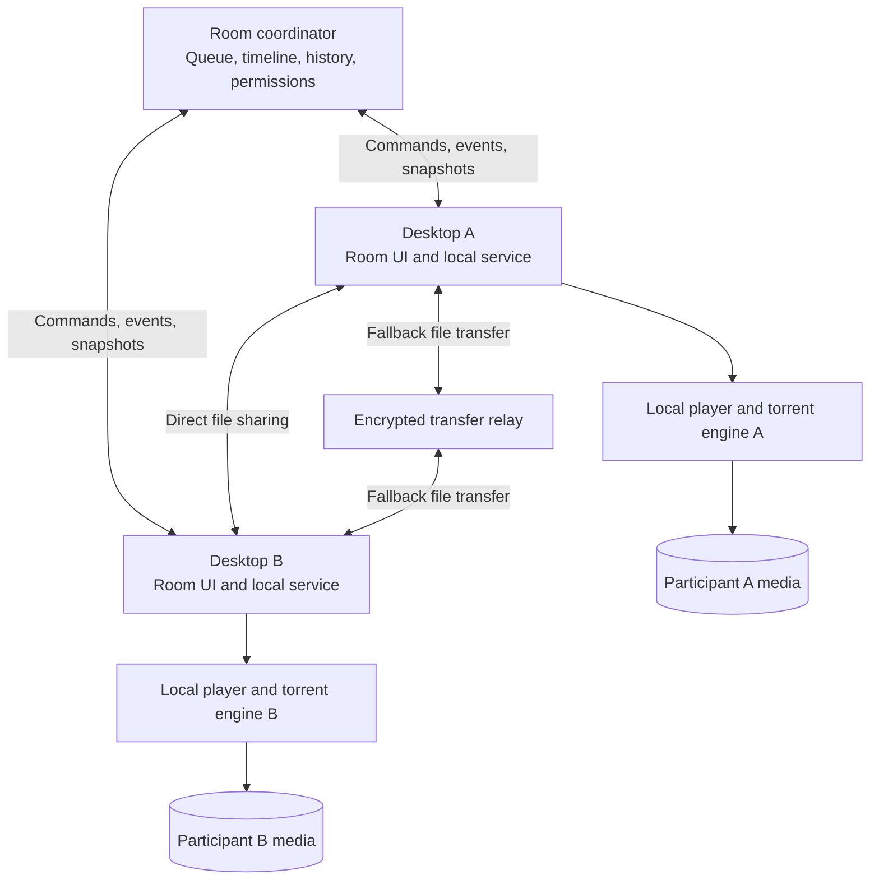

# WatchPair v2 Specification

WatchPair v2 lets a private group watch matching local media together, including while a torrent is downloading. Each participant keeps their own copy. The application combines a shared room and playback queue with a capable local transfer manager, while giving every operation a clear owner and visible status.

This specification records product decisions finalized on 28 October 2026. Build a new Qt desktop implementation with libmpv and libtorrent, followed by a replacement release. The prototype must establish integration feasibility on Windows and Linux before production implementation expands. Alternative frameworks below are retained as the evaluated options, not pending product decisions.

## Confirmed product decisions

| Area | Decision |
| --- | --- |
| Replacement | A clean implementation and a hard cutover are acceptable. Importing v1 rooms, job state, and settings is unnecessary. |
| Platforms | Windows 10/11 x64 and Ubuntu 24.04 or newer x64, with X11 and Wayland validation. Other Linux distributions are initially best effort. Target rooms of 2–8 active watchers. |
| Media delivery | Each participant has their own copy. The coordinator does not host or relay video. |
| Application requirement | Desktop application required for watching. Qt, libmpv, and libtorrent selected for the prototype. Browser playback is deferred. |
| Rooms | Persistent, invite-only rooms with room watch history. No user accounts initially. |
| Collaboration | Every member may play, pause, seek, and edit the shared queue. This supersedes the earlier host-only queue editing rule. |
| Buffering and connection loss | Pause immediately when an active watcher's disconnection or buffer underrun is detected. The host can explicitly continue without a participant. New watchers stage until ready. Host loss pauses until return or an already designated successor takes over. |
| Room administration | Separate member invite and private host recovery link; explicit deletion, host handoff, invite revocation, and no automatic inactivity expiry. |
| Watch participation | Members explicitly press Join watch. Room membership alone does not block playback. |
| Audio and subtitles | Synchronize audio and subtitle choices and subtitle delay across the room. |
| Missing shared track | Pause and explain. Any member can choose a track available to everyone. |
| Local sharing | Sharing local files and folders so others download their own copies is required at launch. |
| Transfer fallback | A separate encrypted relay may carry file transfers when direct connectivity fails. Participants still receive their own copies. |
| Progressive playback | Playback while the episode is still downloading is required at launch. |
| Watched history | Move an episode to Watched after 90% distinct coverage, with manual watched and unwatched actions, relative timestamps, and rewatching. |
| Watched authority | Shared timeline coverage from a designated active reporter, with reporter handoff. Every member may mark watched or unwatched manually. |
| Current episode deselection | Stop playback immediately and move to the next selected unwatched episode, subject to the readiness gate. |
| Transfer interface | Follow qBittorrent's sidebar, dense transfer table, and bottom detail tabs. Prioritize queue order, speed limits, and storage controls. |
| Advanced transfer controls | Include per-transfer moves, tracker editing, seeding limits, and advanced network settings. Playback-needed pieces have priority within explicit local pauses and hard bandwidth limits. |
| Media baseline | MKV/MP4, H.264/HEVC/AV1, multiple audio tracks, multichannel audio, ASS with fonts, image subtitles, and chapters. Tone-map HDR initially; native HDR output and audio bitstream passthrough are deferred. |
| Voice | Defer built-in voice. Use an external voice application initially. |
| Different releases | Automatic alignment is excluded from launch scope and is not a core feature. Require matching media and provide mismatch diagnostics. |

## Feature coverage

The following launch scope implements those decisions. Carrying a capability forward does not require copying its v1 implementation.

| Feature area | Launch coverage |
| --- | --- |
| Room lifecycle | Create a room, join by invite or code, retain rooms and history across restarts, show membership and presence, reconnect, join playback in progress, leave, and recover room administration without an account. |
| Room permissions | All members control playback and queue content. Host administration covers invites, membership, host handoff, room deletion, and readiness overrides. Device identity must be authenticated; a caller-supplied device ID does not confer host rights. |
| Adding media | Magnet links, torrent files, Nyaa page links, direct media URLs, local files, and local folders. Resolve a page into a source before creating a transfer. Unsupported pages produce an actionable error. |
| Multifolder content | Nested seasons and folders, individual episodes, select all or none, folder selection, exclusion of extras, natural episode ordering, search, and bulk actions. Download controls may include all torrent files; only playable videos become room queue entries. |
| Metadata and selection | Retrieve torrent metadata before payload downloads. Always expose selection while metadata is loading. Show the selected size and files before applying. Distinguish metadata discovery from approval to download. |
| Shared queue | Add, remove, rename display labels, reorder, choose an episode, skip, retry, and advance at end of playback. A room queue orders episodes; the local transfer queue orders acquisition work. Their relationship must be visible and explicit. |
| Device acquisition policy | Auto, Ask, and Never. Reuse an available local copy before downloading another. A local manual pause or download refusal survives refresh and restart. Shared room changes do not silently undo local decisions. |
| Transfer management | Add, start, pause, resume, retry, recheck, remove while keeping files, explicitly delete managed files, choose files and priorities, reorder transfers, set global and per-transfer rate limits, limit concurrent work, and configure seeding limits. |
| Transfer visibility | Overall and selected-file progress, verified bytes, availability, current speed, ETA when meaningful, seeds and peers, ratio, tracker state, save location, queue reason, and activity. Sortable and resizable columns, filters, search, multiselection, and keyboard actions. |
| Advanced transfer controls | Reannounce, tracker inspection and editing, peer inspection, connection settings, and a clearly defined offline mode. RSS, search plugins, and automatic episode acquisition are outside the initial scope. |
| Library and reuse | Multiple library roots, background scanning, search, folder browsing, file identification, missing-file detection, and reuse across rooms without duplicate transfers or copies. Publish local files and folders for room participants to download; show hashing, sharing, and actual recipient progress. |
| Playback | Native libmpv playback in the Qt application. Play, pause, seek, playback rate, volume, fullscreen, keyboard controls, chapter navigation, resume position, end-of-file handling, and a clear current episode display. |
| Playback synchronization | Coordinator-authoritative timeline, measured clock offset, readiness barriers, drift correction, serialized conflicting commands, reconnect snapshots, buffering recovery, and visible per-participant reasons for waiting. |
| Audio and subtitles | Shared audio and subtitle choices and subtitle delay; multiple tracks, language preferences, embedded and external subtitles, SRT, VTT, ASS/SSA with attached fonts, and chapters. Distribute external subtitle assets through the sharing mechanism so a shared choice resolves to the same content. Keep volume and accessibility appearance local. Validate multichannel audio and image subtitles before release. |
| Progressive torrent playback | Prioritize verified bytes needed to open the container, decode ahead, and seek. Fetch required headers and indexes even when they occur near the end of a file. Prefetch upcoming episodes without starving current playback. |
| Watched history | Distinct played intervals, automatic 90% threshold, manual episode and folder actions, watched timestamps, search, Watch again, and preservation when a source is removed from the active queue. |
| Storage | Download directory selection, per-transfer location and moves, library roots, cache accounting, pins, age and capacity policies, free-space reserve, cleanup preview, and restart-safe filesystem operations. |
| Application lifecycle | Tray behavior, startup preferences, protocol links, single-instance handling, install and update flows, interrupted-update recovery, and graceful shutdown with persisted transfer state. |
| Diagnostics | Structured error codes and operation IDs, bounded activity logs, progress and wait reasons, retry and repair actions, redacted diagnostic export, and effective resource and network settings. |
| Hosting and releases | One self-hostable coordinator, a separately configured encrypted transfer relay, persistent database, Docker deployment, backup and restore, health and version endpoints, tested Windows and Linux packages, compatible protocol versions, and rollback. |

Original-quality playback is the default aim. The release support matrix covers the agreed codecs, subtitles, multichannel output, HDR tone mapping, Windows versions, Ubuntu baseline, X11, and Wayland. Unusual codecs and hardware-specific output require explicit validation. Native HDR output and audio bitstream passthrough are later features.

## Integrated behavior

### Add a season pack and start watching

1. A member adds a magnet, torrent file, or supported page link in the desktop app.
2. The local service resolves the source and retrieves metadata. No video payload is selected until the member applies a choice.
3. The content view shows nested folders, episode names, extras, sizes, and any existing local copies. The member chooses files and whether the selection applies to the room or only this device.
4. A shared edit is accepted by the coordinator before it appears as confirmed room state. Every member may make this edit. Conflicting edits are ordered or rejected with the current revision, rather than silently overwriting another member.
5. Each participant's local service follows the accepted room selection under its own Auto, Ask, or Never policy. A physical transfer can satisfy several room references.
6. For the selected episode, the local service requests startup metadata and a playable window of verified pieces. The player uses a reader that waits for real data; an unfilled sparse-file range is never presented as valid video.
7. The room shows each active watcher's availability and buffer status. Once all required watchers can open and buffer the target, playback starts against a coordinated timeline.
8. The transfer scheduler continues filling the playback window, then the next selected episode, then background work within the user's limits.

### Seek while downloading

A seek is a shared command against the current playback generation. Every required watcher maps the requested time to their matching media and requests the necessary bytes. The room pauses until the new target is playable everywhere. Obsolete reads and piece priorities are canceled or reduced. Old seek completion callbacks cannot resume a newer seek or another episode.

The UI distinguishes a valid seek waiting on download from an invalid target, unavailable pieces, decoder failure, or source mismatch. Sequential downloading alone is insufficient: streaming requires deadlines and reprioritization for the bytes actually needed. [libtorrent streaming design](https://www.libtorrent.org/streaming.html)

### Change the shared selection during playback

Any member can edit the room queue. If the current episode is removed or deselected, the coordinator stops it, chooses the next selected unwatched episode, and establishes a new readiness barrier. If no episode remains, playback stays stopped.

A device-only selection, pause, or bandwidth change affects that device. If it prevents that participant from watching, the room shows the participant as waiting and follows the agreed pause policy. A clearly labeled shared action is required to alter the room queue.

### Buffer or lose a connection

An active watcher's underrun pauses the shared timeline. Losing its connection freezes the room at the authoritative playback position immediately once the loss is detected, without an added grace period. A closed transport is detected immediately; a silent network loss requires heartbeat failure detection and cannot be detected instantaneously. The host can explicitly continue without that watcher. A later reconnect uses a fresh snapshot and readiness check before the watcher rejoins active playback. If the host disconnects, remain paused until it returns or a previously designated successor takes over.

An application reconnect must not duplicate membership or downloads. Members explicitly press Join watch and can leave the watch while remaining room members. Merely joining the room does not add a readiness requirement. Admission to an already playing watch is separate from an active participant's buffering: stage a new watcher until ready, then admit it against the current timeline. Opening transfer settings does not remove an already active watcher. Heartbeat detection is configurable; start with a one-second heartbeat and a three-second silent-loss deadline, while pausing immediately on a closed transport or explicit failure signal.

### Choose audio and subtitles

Audio track, subtitle track, and subtitle delay are shared room commands, alongside play, pause, seek, and rate. Resolve a shared choice into each player's local track identifiers; do not pass one player's transient track ID directly to another. A missing track or external subtitle asset pauses the room with an explicit reason. Any member may choose a compatible track available to all. External subtitle assets must be available to every active watcher before the shared choice takes effect. Volume, output device, and accessibility appearance remain local.

### Mark watched and rewatch

Coverage counts the distinct room-timeline intervals actually played. Seeking forward or replaying the same interval does not inflate coverage. The coordinator accepts coverage from a designated active player, preferring the host when it is watching. The reporter and playback generation are explicit so reporter handoff preserves valid coverage and rejects stale reports. Every member can mark watched or unwatched manually.

At 90%, the episode moves out of the upcoming queue into Watched. Its current playback continues to the end, and Now playing remains visible. Marking it watched must not cancel the remaining download: progressive playback may still need those bytes. A completion stores an absolute timestamp and displays relative age. Manual actions record their method, and Watch again creates a new viewing while retaining earlier completions.

Watched state, queue inclusion, download selection, and file retention are separate decisions. Marking watched never means deleting files. Proposed behavior is to offer skipping already watched episodes when adding a pack, while leaving existing transfers under explicit local control.

### Reuse and clean up media

Rooms reference content; local transfers and files belong to the device. A second room reuses the same torrent and verified data. Its episode selection remains independent. The required physical file selection is the union of the active local demands, subject to explicit local overrides.

Removing a room reference does not delete another room's data. Cleanup protects active playback, required data for ongoing sharing, and pins. An inactive room reference is not an indefinite storage reservation; losing its local copy changes availability and may require a future download. External library files are never silently adopted as disposable managed downloads.

Moving a download is a recoverable operation with progress, a persisted intent, and a verified final location. Database commits and filesystem moves are not one atomic transaction; interrupted moves must be reconciled on restart.

## Architecture proposal

Use one coordinator, a separate relay for fallback transfers, and one desktop application per participant. The application contains a local service and thin presentation layers. Keep deployment small; separate logical modules do not require a fleet of services.

The diagram shows ownership and control. Torrent bytes travel through the swarm or participant sharing, independently of coordinator commands. The coordinator carries no video bytes. A small website can provide invites, installation links, and room entry without being a second playback implementation.

Local file and folder sharing is a required acquisition path. The sender publishes a manifest, hashes content, and serves it while recipients obtain their own copies. Direct connectivity is not guaranteed by a torrent engine: the prototype must include restrictive-NAT cases, sender disconnection, and resumable transfers. An encrypted relay fallback is approved. Keep it a separately operated transfer component with short-lived authorization, visible relay status, and bandwidth limits; the coordinator still carries no video bytes. Deferring voice does not eliminate this connectivity work.

One candidate is a WebRTC data-channel adapter with direct ICE connectivity and TURN fallback. The adapter transfers requested, verifiable chunks into the same local availability model used by torrents. It must support cancellation, backpressure, resume, and priority for current playback rather than creating a second room scheduler. A native library such as libdatachannel can be evaluated for the Qt implementation; it is a candidate, not a selected or tested dependency. [libdatachannel](https://github.com/paullouisageneau/libdatachannel), [WebRTC specification](https://www.w3.org/TR/webrtc/)

| Module | Authoritative responsibility |
| --- | --- |
| Coordinator | Room membership and roles, accepted queue edits, active watchers, playback generation and position, readiness barriers, watched history, and administration. |
| Local application service | Acquisition policy, local transfer commands, file bindings and locations, actual availability, priorities, persistence, and reconciliation after restart. |
| Torrent adapter | Metadata, file and piece availability, verification, deadlines, pause and resume, peer and tracker state, and engine resume data. It does not decide room policy. |
| Private sharing adapter | Authorized local-file transfer, direct connectivity and encrypted relay fallback, verifiable chunks, backpressure, resume, and progress. It feeds the local service's availability and priority model. |
| Playback adapter | Opening media, buffer and decoder status, position and drift observations, seeks, audio and subtitle tracks, and end-of-file events. It does not independently advance the room queue. |
| Library and storage | Local content identification, catalog, safe file operations, pins, retention, and cache accounting. |
| Desktop interface | Presents state and submits commands. It does not recreate transfer scheduling through view lifecycle callbacks. |

The desktop service connects directly to the coordinator using scoped device credentials. Its room control does not depend on a browser tab renewing a connection. Room invites, member credentials, and host recovery authority are distinct; host administration needs an explicit recovery and handoff mechanism without accounts.

### Identity and data model

Keep these objects separate:

- Room, member identity, connected device, and active watcher.
- Acquisition source, torrent manifest, torrent file, local transfer, and local file location.
- Media asset, room queue entry, local playback binding, playback session, and viewing history.

A room entry points at media; it is not a download directory name. Torrent identities include the torrent identity and original manifest file index, never the row number after filtering to videos. Local paths can change without changing room identity. A selected file belongs to a validated manifest before it is offered as playable.

Identical torrent content can be recognized before full download using its manifest and subsequently verified pieces. Local and direct sources need an explicit identification strategy; preliminary matches must be distinguishable from verified identity. Filenames alone cannot establish that two participants have matching media. Different encodes or cuts do not receive automatic timeline alignment at launch.

### Commands and synchronization

Use a versioned, language-neutral protocol with runtime validation and shared fixtures. HTTP commands with WebSocket events are a reasonable initial transport. Transport does not own business rules.

- Mutations carry operation IDs and relevant revisions; retrying an acknowledged operation does not duplicate it.
- Queue edits use a queue revision rather than failing because an unrelated heartbeat changed a global counter.
- Accepted room changes commit with a monotonically ordered room event revision. Reconnect uses a snapshot and subsequent ordered events, with a full snapshot when a gap cannot be replayed.
- Playback carries its own generation, reference position, coordinator time, rate, and paused state. Clients estimate clock offset and measure drift instead of equating message receipt with the playback target time.
- A readiness barrier identifies the episode, target time, generation, and required active watchers. Stale status cannot satisfy a new barrier.
- Native player callbacks distinguish commanded actions from local user actions, preventing feedback loops.
- Local transfer and room edits are separate transactions. Display pending, accepted, failed, and reconciled outcomes; do not imply a distributed atomic write.

### State and persistence

Model availability on separate axes: acquisition, verified data ranges, playback buffer, source identity, active room binding, and watched state. A single percentage or generic ready flag cannot represent all of them.

During progressive playback, 20% downloaded may contain a playable start, while 95% may still lack the bytes needed for a seek. Expose the buffer window and exact wait reason. The readiness decision belongs to one local service rule and feeds both UI and coordinator reports.

Propose SQLite for the coordinator and a separate local SQLite database on each device. Keep engine resume blobs and reconstructible indexes under an explicit persistence policy. Commit related intent records together; reconcile them with actual files and engine state after a crash. Persist user intent such as manual pauses and limits independently of transient telemetry. SQLite suits application-local storage and modest single-server deployments. [SQLite use cases](https://www.sqlite.org/whentouse.html)

### Local access and privacy

Use authenticated local IPC for privileged controls. If playback requires a loopback HTTP reader, restrict it to the local machine and authorize the player rather than exposing arbitrary filesystem paths. A future browser integration would need explicit origin approval and revocable pairing.

Room connections use TLS and scoped member credentials. Invites can be revoked without making every member a host. Source URLs, tracker credentials, room credentials, and private local paths are redacted from diagnostics; the coordinator receives only metadata required for the room. File operations enforce managed-directory ownership and path containment. Torrent privacy flags and discovery settings remain effective during room sharing.

## Playback options

| Option | Advantages for WatchPair | Costs and limitations | Assessment |
| --- | --- | --- | --- |
| Native playback through libmpv | Reads original local media, supports many codecs and subtitle types, exposes playback control and timing, and can avoid most browser conversion and subtitle extraction machinery. | Embedding, fullscreen, keyboard focus, GPU drivers, Linux X11 and Wayland, packaging, and partial-file reading still require real integration work. | Leading candidate now that desktop-required watching is acceptable. |
| Browser playback with a local service | Familiar web room, browser media APIs, and potential browser-only local-file support. | Unsupported media can require remuxing or transcoding, prepared-file caches, subtitle extraction and rendering, and localhost permissions. Progressive download plus conversion adds another scheduling layer. | Viable, but carries more media-pipeline responsibilities for the intended formats. |
| Native and browser playback at equal launch parity | Participants choose their interface. | Two playback backends, two readiness models, and a much larger compatibility and synchronization matrix. | Defer browser playback unless a separate product need justifies it. |

mpv explicitly provides libmpv for embedding and exposes command and event interfaces. This supports the architectural direction, not a guarantee that all platform integration is solved. [mpv embedding documentation](https://mpv.io/manual/stable/#embedding-into-other-programs-libmpv)

## Desktop framework comparison

These are engineering judgments for WatchPair, not benchmark results. A smaller shell does not necessarily produce a simpler application once the torrent engine, player, and their native dependencies are included.

| Framework | Advantages | Disadvantages | Fit |
| --- | --- | --- | --- |
| Qt Widgets or Qt Quick with C++ | Native desktop UI, direct access to C++ libtorrent and the libmpv C API, and a model/view approach suited to dense transfer tables. Deferring voice removes a major immediate native integration requirement. | C++ ownership and concurrency require care; native dependencies and updates need packaging work; a future web UI would use a separate view implementation. Reliable local sharing across restrictive NAT may still need another transport. Qt Widgets favors conventional desktop controls, while QML introduces a separate declarative UI layer. | Strongest native candidate to prototype first. Prefer Qt Widgets for the transfer desk; assess the player surface and sharing transport separately. |
| Electron with a TypeScript web UI | Bundled Chromium gives a consistent web renderer. Web UI tooling, desktop lifecycle support, and Node integrations are available. A future browser interface can share components. | Larger bundled runtime. Native libtorrent and libmpv still need a helper or binding; seamless native video integration adds platform-specific work. Remaining in JavaScript does not remove native media boundaries. | Strong alternative if web UI development and future browser reuse outweigh native integration simplicity. |
| Tauri with a TypeScript web UI and Rust core | Uses the operating system webview, supports a Rust application core, and can bundle native helpers. Attractive when a web interface and a smaller shell are important. | Webview differences across Windows and Linux; C++ torrent integration still needs a bridge or helper; Rust, frontend, and native-library packaging can become three maintenance surfaces. Native video embedding remains a prototype requirement. | Credible alternative, but lower shell size alone is insufficient reason to choose it. |

Qt documents native desktop widgets and model/view tables. Electron documents its Chromium and Node process model. Tauri documents its system webviews and platform-specific helper packaging. [Qt Widgets](https://doc.qt.io/qt-6/qtwidgets-index.html), [Qt Quick](https://doc.qt.io/qt-6/qtquick-index.html), [Electron](https://www.electronjs.org/docs/latest/tutorial/process-model), [Tauri process model](https://tauri.app/concept/process-model/), [Tauri helpers](https://tauri.app/develop/sidecar/)

### Frontend choices for a web interface

| Option | Strength | Tradeoff |
| --- | --- | --- |
| React and TypeScript with Vite | Component-based UI with explicit state composition; suitable for sharing web-based room and desktop views. | Requires disciplined state ownership; putting orchestration into effects can reproduce the current problems. |
| Vue and TypeScript with Vite | Template-based single-file components and a structured reactive model. | A different UI model and dependency set; reactive watchers still need the same architectural boundaries. |
| Svelte and TypeScript with Vite | Compiler-based components and concise UI expressions. | Its component and reactivity model differs from React and Vue; a smaller component does not replace application services or protocol design. |

Any of these can implement a thin interface. Choose based on the framework prototype and maintainability rather than expecting the frontend to repair state ownership. A Next, Nuxt, or SvelteKit server-rendering layer is optional for the invite website and unnecessary for a local desktop UI. [React state guidance](https://react.dev/learn/managing-state), [Vue introduction](https://vuejs.org/guide/introduction.html), [Svelte overview](https://svelte.dev/docs/svelte/overview), [Vite guide](https://vite.dev/guide/)

### Coordinator choices

| Option | Advantages | Tradeoffs |
| --- | --- | --- |
| TypeScript with Fastify | Straightforward HTTP service, schema validation, and a good fit if web interfaces use TypeScript. | CPU-heavy media work must remain outside the coordinator; TypeScript types still need runtime validation. |
| Rust with Axum | Explicit types and concurrency with a compact native server deployment; a fit if Rust becomes the client service language. | Adds another language when the client is Qt/C++; provides little benefit by itself for a small room coordinator. |

Initial preference is a small Fastify coordinator with SQLite unless prototype results make a shared Rust core materially useful. The server framework can be selected independently of the desktop shell. Neither choice requires microservices, Redis, Kafka, or a separate distributed database. [Fastify validation](https://fastify.dev/docs/latest/Reference/Validation-and-Serialization/), [Axum](https://docs.rs/axum/latest/axum/)

## Torrent engine comparison

| Option | Advantages | Costs and limits | Assessment |
| --- | --- | --- | --- |
| libtorrent behind an application adapter | Exposes piece deadlines, verification, resume data, file priorities, limits, queue control, trackers, and storage moves. Suitable for both progressive playback and a substantial transfer manager. | Native builds, API integration, resume persistence, and Windows/Linux packaging. It does not supply WatchPair's media reader, room model, or UI. | Leading candidate. Test direct control of the pieces needed by the player. |
| A managed qBittorrent service through its Web API | Existing transfer behavior and broad file, queue, tracker, and storage APIs. Can also integrate an independently installed client later. | Additional application lifecycle and profile ownership. The Web API may not expose the precise piece-deadline and read coordination needed for progressive seeking. OS packaging and managed-service availability must be proven. | Alternative if the playback prototype succeeds through the API; do not assume the API equals direct libtorrent access. |
| WebTorrent | Node integration and browser-compatible torrent networking; public file selection APIs. | Current app requires extra behavior around networking and state. A clean v2 still needs to prove pause semantics, large-pack recovery, and streaming priorities through supported APIs. | Retain as a comparison candidate, with no obligation to preserve it for compatibility. |

qBittorrent itself uses Qt and libtorrent. Its API exposes useful controls, but that does not establish support for every streaming operation WatchPair needs. [qBittorrent](https://www.qbittorrent.org/), [qBittorrent Web API](https://github.com/qbittorrent/qBittorrent/wiki/WebUI-API-%28qBittorrent-5.0%29), [libtorrent API](https://www.libtorrent.org/reference-Torrent_Handle.html), [WebTorrent API](https://webtorrent.io/docs)

## Acceptance criteria

Acceptance is organized around complete user workflows, not screen-by-screen feature presence.

| Scenario | Required result |
| --- | --- |
| Fresh install on Windows and Linux | Join an invite, select media, see actual local state, and watch without installing a language runtime or configuring a CLI. |
| Large season pack | Choose nested folders and exclude extras in fixtures with thousands of files; preserve original manifest indexes; keep rendering and payload sizes bounded. |
| Progressive start | Open representative incomplete MKV and MP4 files with startup information in different locations. Never serve absent or unverified torrent bytes as media. |
| Progressive seek | Seek beyond downloaded data; prioritize the required pieces, cancel old work, and resume only after every required watcher can play that generation. |
| Slow or unavailable swarm | Show why playback is waiting; remain responsive; allow local pause and explicit host continuation without promising unavailable data. |
| Shared controls | Concurrent queue edits, seeks, and deselection produce one accepted room result; stale callbacks cannot restore old state. |
| Shared audio and subtitles | A shared track or delay command takes effect consistently; track IDs resolve locally; a missing subtitle asset is fetched or reported rather than silently ignored. |
| Local media sharing | Publish a local folder, show hashing and receiver progress, download recipients' own verified copies, recover after either side restarts, and test the agreed connectivity fallback under restrictive NAT. |
| Manual override | A local pause, Never policy, priority, or rate limit remains effective across room refresh, reconnect, and application restart. |
| Shared torrent reuse | Two rooms and different selections use one physical transfer; one room's removal does not invalidate the other. |
| Matching and mismatch | Matching torrent entries bind consistently; wrong episodes, file-index errors, different cuts, and wrong local copies produce an actionable mismatch instead of silent playback. |
| Media compatibility | Validate the agreed codec, audio, subtitle/font, chapter, GPU, Windows path, X11, and Wayland matrix on packaged apps. |
| Watch history | Distinct 90% coverage moves the episode to Watched without stopping the current stream or its download; timestamps and rewatch history survive restarts. |
| Disconnection | Pause for required watchers, show the reason, accept an explicit host override, and rejoin from a current snapshot. |
| Storage interruption | Disk full, moved or missing files, a destination collision, and a restart during a move or cleanup yield recoverable state without deleting unrelated files. |
| Application update | Preserve v2 state, reject incompatible protocols with a clear update action, and recover from an interrupted update. |

The prototype must record drift, startup and seek latency, UI responsiveness, process count, memory, and recovery behavior on named reference machines. Agree numeric budgets and supported Linux distributions before treating these measurements as a release gate. Proposed scale fixtures include 2,000 and 10,000 manifest entries and two to eight room participants; these are planning targets, not measured capacity claims.

## Delivery plan

1. Use the finalized product rules and launch scope above. Produce a coherent room and transfer UI model before implementing isolated screens.
2. Prototype libtorrent plus a seekable verified-data reader and libmpv on both platforms. Exercise progressive start, seeks, cancellation, local pauses, long and Unicode paths, and large manifests. Prove local file and folder sharing across the required network conditions and identify any necessary fallback. This is the first feasibility gate.
3. Validate the selected Qt native player surface, transfer table, and private-sharing transport with relay fallback. Test packaging, fullscreen, focus, GPU behavior, Linux display systems, and updates. Revisit a framework only if a concrete feasibility failure requires it; do not maintain parallel shell implementations.
4. Build the new room protocol, persistence, membership model, queue, player timeline, and readiness barrier. Use controlled local fixtures and simulated network delay before adding unrelated features.
5. Deliver one complete workflow: join, add pack, select folders, start while downloading, seek, pause for a slow watcher, advance, record watched history, restart, and recover.
6. Complete the launch transfer controls, library, storage operations, application lifecycle, diagnostics, and install flows. Run the same workflows in packaged Windows and Linux builds.
7. Run a small release-candidate trial, resolve workflow failures, and perform the hard cutover. Keep v1 available until the release candidate satisfies the agreed acceptance matrix.

There is no legacy compatibility bridge in this plan. Building the replacement in testable increments does not imply migrating the old implementation module by module.

## Hard cutover plan

1. Preserve the v1 source and release tag for reference and rollback. Develop v2 in a separate source tree or branch with its own profiles and protocol version. The v1 code provides examples and regression cases, not mandatory modules to port.
2. Test v2 using a separate coordinator database and local application profile. Do not reinterpret v1 state files, resume records, or cache folders as v2 records.
3. Publish a tested v2 installer and a matching coordinator release. Either provide an updater path that explicitly introduces the reset or require a fresh install, based on the chosen packaging system.
4. Explain that existing room links, room history, local job records, and settings do not carry over. Existing downloaded media remains untouched. Users may manually rescan or re-add it; torrent data can be rechecked if the new engine supports the discovered layout.
5. Stop or detect a running v1 local service before v2 takes over protocol links or listener ports. Do not run two transfer engines against the same managed writable files.
6. Back up the old coordinator data, switch the public service, and validate invites, room persistence, progressive playback, synchronization, history, and installer metadata against the actual deployed revision.
7. Keep rollback artifacts until the replacement is stable. A rollback restores the v1 service and profile; it does not promise to translate new v2 rooms back into v1.

Future v2 releases still need their own schema migrations and compatible update behavior. Dropping v1 migration only removes the initial legacy import requirement.

## Deferred features

- Built-in voice and its WebRTC or native media integration.
- Automatic alignment of different releases, edits, recaps, or cuts. This is not a core launch feature.
- Browser playback at equal parity with native playback.
- Host-to-viewer playback streaming and central media hosting. Encrypted relay fallback for file-copy traffic is included in launch scope.
- User accounts, personal cross-room watch history, public discovery, and social features.
- macOS and mobile clients.
- RSS acquisition, provider search plugins, automatic episode downloading, and literal parity with every qBittorrent feature.
- Transparent migration of v1 rooms, settings, transfer jobs, and preparation caches.

## Engineering defaults and prototype evidence

Product choices are settled for the prototype. The following implementation defaults can be tuned with measured evidence without reopening launch scope:

1. Use Qt Widgets and CMake, libmpv for native playback, and libtorrent through a narrow transfer adapter. Start the coordinator with TypeScript, Fastify, and SQLite when room implementation begins.
2. Heartbeat every second; treat three seconds without a response as silent loss. Pause immediately when loss or underrun is detected. These intervals are detection settings, not an intentional playback grace period.
3. Use separate scoped member credentials and a revocable host recovery credential. Persist rooms until explicit deletion. Host handoff requires explicit authorization; reconnect does not grant administration to an arbitrary member.
4. Prioritize the current playback window, then upcoming episodes, then manual background order. Manual pauses and hard bandwidth limits always apply. Display the effective scheduling reason.
5. The implemented transport uses authenticated encrypted direct TCP with a separate opaque HTTPS relay fallback. This avoids introducing a browser/WebRTC stack into the native file-copy service. Member device keys use X25519/HKDF and AES-GCM; static device keys do not provide forward secrecy, and the coordinator is trusted to distribute member keys. Relay tickets expire after 60 seconds, authenticate admission before reading a body, and bind the room, member pair and direction. The relay has no media disk storage; memory includes incoming reservations and in-flight responses (64 MiB by default), frames are capped at 2 MiB, channels at 1,024, and global/per-channel ingress and egress ceilings are configurable. Test direct and forced-relay operation and validate the public TLS deployment before release.
6. Prototype performance goals are steady-state playback drift at or below 150 ms under the controlled two-client test, bounded byte and piece caches, and a responsive interface with 2,000 and 10,000 manifest entries. Record machines, versions, network conditions, and measured failures. Extend to eight watchers before release.
7. Validate Windows 10/11 and Ubuntu 24.04+ packages, both Linux display systems, and the agreed media matrix before claiming release support. A successful WSL or headless test does not establish every GPU, HDR, desktop, or Linux distribution combination.
8. Native HDR output, audio bitstream passthrough, built-in voice, browser playback parity, and cross-release alignment remain outside launch scope.

The first prototype established Qt/libmpv/libtorrent integration, verified progressive reading, real incomplete-torrent playback and seeking, manual pause, and restart behavior on Windows and Linux. Its historical results are recorded in [the prototype validation report](../v2/prototype/VALIDATION.md). The integrated application, room coordinator, transfer controls, private sharing/relay, media matrix, installers and update recovery are now implemented. Current stage reviews, packaged acceptance evidence and remaining physical-platform/operator release gates are recorded in [the implementation report](../v2/IMPLEMENTATION.md). Linux virtual acceptance uses the documented Mesa softpipe workaround; it does not establish physical GPU qualification.
